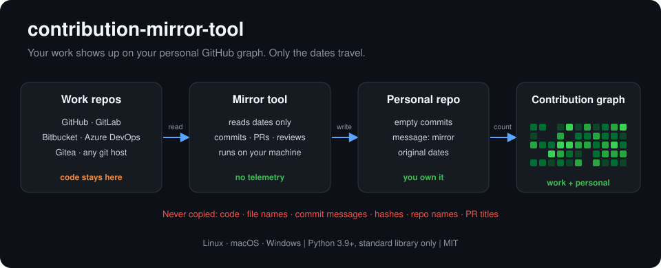
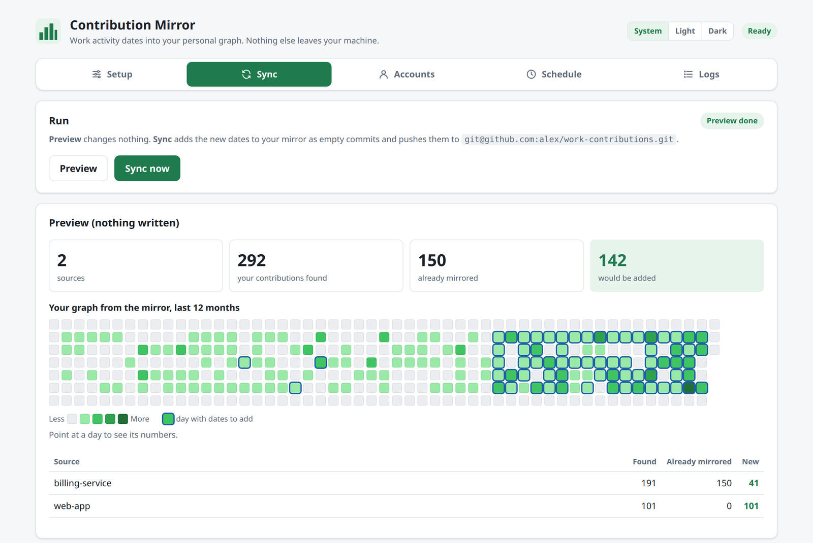
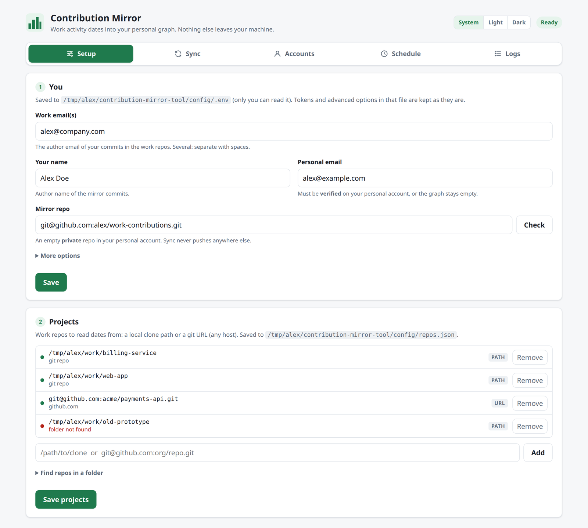
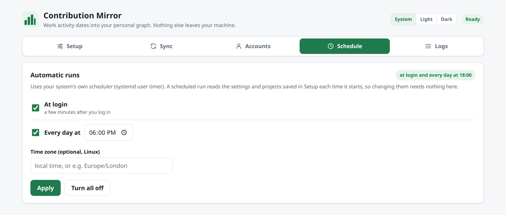
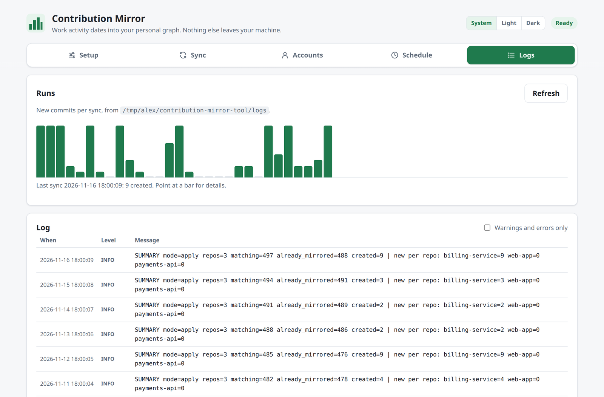

<p align="center">
  
</p>

<p align="center">
  <a href="https://github.com/Majid-Ali-Watto/contribution-mirror-tool/actions/workflows/tests.yml"></a>
  <a href="LICENSE"></a>
  
  
  <a href="https://majidev.netlify.app"></a>
</p>

# Contribution Mirror

Copies the **timestamps** of your work activity (commits, pull requests, reviews) into a separate personal repo as empty commits, so your personal GitHub contribution graph reflects your work without exposing any work code.

- **Nothing private is copied.** Only dates are read and written: no code, file names, paths, commit messages, hashes, repo names or PR titles. Your work repos are never modified. [Details](docs/how-it-works.md)
- **Works on Linux, macOS and Windows.** One Python implementation, thin wrappers for each shell. [Platforms](docs/platforms.md)
- **Works with any git host, in any combination.** Work repos on GitHub, GitLab, Bitbucket, Azure DevOps, Gitea/Forgejo or anything else that speaks git, mirrored into a repo on the same host or another one. GitHub to GitHub is the verified setup. [Hosts](docs/hosts.md)
- **No setup beyond your project URLs.** It uses ssh, https or the host's CLI, whichever you already use. [Authentication](docs/authentication.md)
- **Fast and safe to re-run.** A normal run takes a few seconds, and only timestamps not already in the mirror are added. [Performance](docs/performance.md)

> **How much is verified.** The Linux path and GitHub are verified on real accounts. macOS, Windows and the non-GitHub
> hosts, and mirrors on a host other than GitHub, are implemented and covered by an offline test suite (a CI workflow runs it on all three systems), but I could
> not run them on a real Mac, Windows PC or GitLab / Bitbucket / Azure DevOps / Gitea account. Commits are mirrored
> everywhere; if an extra (a pull request lookup, a notification) fails you get a warning, not a failed run. See
> [platforms](docs/platforms.md) and [hosts](docs/hosts.md).

## Quick start

**New here? Follow [Getting started](docs/getting-started.md)**: a step-by-step guide from cloning to your first
sync, with the setup page or with commands, plus troubleshooting. The short version:

**With the setup page:** run `make ui` (or `python3 -I src/mirror.py ui`; Windows: `py -3 -I src\mirror.py ui`), fill in
Setup, then Preview and Sync. **With files and commands:**

1. Create an empty **private** repo on your personal GitHub account (the "mirror").
2. Create your two files from the templates, then fill them in: `make setup` on Linux / macOS, or `python3 -I src/mirror.py setup`
   (Windows: `py -3 -I src\mirror.py setup`). It never overwrites a file, makes them private to you, and prints where they are.
   `.env` holds your emails and the mirror repo; `repos.json` lists your projects (clone paths and/or git URLs of any host).
   Both live outside the code, so nothing private is ever committed ([where the files are](docs/configuration.md#where-the-files-are)).
3. Preview, then run:

   | | Linux / macOS | Windows |
   | --- | --- | --- |
   | preview (changes nothing) | `scripts/sync.sh --dry-run` | `scripts\sync.cmd --dry-run` |
   | mirror and push | `scripts/sync.sh` | `scripts\sync.cmd` |

   (Both are wrappers for `python3 -I src/mirror.py sync` / `py -3 -I src\mirror.py sync`.)
4. On GitHub enable **Profile > Contribution settings > Include private contributions on my profile**.
5. Optional, run it automatically at login and/or daily on any system: `python3 -I src/mirror.py schedule install`
   (`--time 14:00`, `--no-login`, `--no-daily`; `uninstall` stops it), or the Schedule tab of the page below ([Scheduling](docs/scheduling.md)).

**Prefer a page to files and commands?** `python3 -I src/mirror.py ui` (Windows: `py -3 -I src\mirror.py ui`) opens a
local page in your browser: set up, preview with a calendar, sync, see which login each host uses, turn automatic runs
on or off, and read the log. See [GUI](docs/gui.md).

<p align="center">
  <picture>
    <source media="(prefers-color-scheme: dark)" srcset="docs/assets/ui-sync-dark.png">
    
  </picture>
  <br><sub>The Sync tab after a preview (demo data): what would be added, per project, on a 12-month calendar.</sub>
</p>

**On Linux or macOS?** `make help` lists short forms of everything: `make ui`, `make preview`, `make sync`,
`make schedule TIME=14:00`, `make schedule-off`, `make test`.

## Screenshots

The setup page (`make ui`), with demo data. The Sync tab is shown above; the light or dark version follows your
GitHub theme.

<p align="center">
  <picture>
    <source media="(prefers-color-scheme: dark)" srcset="docs/assets/ui-setup-dark.png">
    
  </picture>
  <br><sub><b>Setup</b>: your details and projects, each entry checked (here one folder is missing).</sub>
</p>

<p align="center">
  <picture>
    <source media="(prefers-color-scheme: dark)" srcset="docs/assets/ui-schedule-dark.png">
    
  </picture>
  <br><sub><b>Schedule</b>: turn the run at login and the daily run on or off, and pick the time.</sub>
</p>

<p align="center">
  <picture>
    <source media="(prefers-color-scheme: dark)" srcset="docs/assets/ui-logs-dark.png">
    
  </picture>
  <br><sub><b>Logs</b>: new commits per sync, and the log with a filter for warnings and errors.</sub>
</p>

The **Accounts** tab lists, for each host, the login used for pull requests and reviews. See [GUI](docs/gui.md) for every
tab.

## Project layout

```
contribution-mirror-tool/
├── README.md
├── CLAUDE.md                   notes for contributors and Claude Code: rules, layout, pitfalls
├── Makefile                    short forms of the common commands (make help)
├── pyproject.toml              packaging metadata only (pipx install . adds a contribution-mirror command)
├── config/                     optional, see above
│   └── (optional) .env, repos.json   only in a checkout that already had them; otherwise see docs/configuration.md
├── scripts/                    one-line wrappers around the Python entry point
│   ├── sync.sh, sync.cmd                       mirror + push
│   └── scheduled-sync.sh, scheduled-sync.cmd   what an OS scheduler runs
├── src/
│   ├── mirror.py               Python entry point (sync | scheduled | schedule | accounts | doctor | setup | ui | core)
│   └── contribution_mirror/    the code, one module per responsibility
│       ├── __main__.py         `python -I -m contribution_mirror` (installed copy)
│       ├── templates/          env.example, repos.example.json: the templates `setup` copies
│       ├── cli.py              command dispatch, and the core run's steps in order
│       ├── sync.py             mirror + push          scheduled.py   network wait, notify, errors
│       ├── schedule.py         systemd / launchd / Task Scheduler      notify.py   desktop notifications
│       ├── ui.py, ui_static/   the local setup and sync page (`mirror.py ui`)
│       ├── accounts.py         which login each host would use (`mirror.py accounts`)
│       ├── doctor.py           check the whole setup, with fixes (`mirror.py doctor`)
│       ├── push.py             safe push, first-run remote, token fallback
│       ├── config.py, envfile.py, settings.py      your settings, safe .env parser, paths and limits
│       ├── repos.py            which projects to scan (paths, URLs, grouping by host)
│       ├── scan.py, gitutil.py reading commit dates, running git, auth environment
│       ├── remotes.py          URL parsing: owner/repo, ssh alias -> real host, Azure DevOps forms
│       ├── credentials.py      find a login automatically and pick the right account
│       ├── httpapi.py          small HTTPS JSON client (retries, https-only tokens)
│       ├── providers/          one small file per git host: github, gitlab, bitbucket, azure, gitea
│       ├── activity.py, state.py   PRs and reviews: account, window, incremental scans (per host)
│       ├── runlock.py          one run at a time
│       ├── mirror_repo.py      read the mirror, catch up with your personal repo, write new empty commits
│       ├── report.py           the output of a run, and reading it and the logs back (the page uses this)
│       ├── logsetup.py, fsutil.py   logging; private files and folders (0600 / 0700); redaction
│       ├── timeutil.py         timestamps from every vendor
├── tests/                      offline tests, stdlib only (python -m unittest discover -s tests)
├── docs/                       getting started, gui, usage, configuration, authentication, hosts, platforms, scheduling, how it works, performance, logs, privacy, terms
│   └── assets/                 overview.svg (the diagram above), ui-*-light/dark.png (setup page screenshots)
├── .github/workflows/tests.yml runs the tests on Ubuntu, macOS and Windows
├── .github/rulesets/           the default-branch ruleset, importable (see docs/branch-protection.md)
├── LICENSE                     MIT
└── logs/                       optional, see above (default: your per-user log folder)
```

## Documentation

| Topic | Read |
| --- | --- |
| **First setup, step by step (start here)** | [docs/getting-started.md](docs/getting-started.md) |
| The setup and sync page in your browser, and how it is secured | [docs/gui.md](docs/gui.md) |
| Commands, `sync`, core options, scanning folders | [docs/usage.md](docs/usage.md) |
| Your settings (`.env`), your project list (`repos.json`), where the files are, every setting | [docs/configuration.md](docs/configuration.md) |
| ssh, https, CLIs, tokens, how the right account is chosen | [docs/authentication.md](docs/authentication.md) |
| GitHub, GitLab, Bitbucket, Azure DevOps, Gitea: what each supports, and which source/mirror combinations work | [docs/hosts.md](docs/hosts.md) |
| Linux, macOS, Windows: requirements, differences | [docs/platforms.md](docs/platforms.md) |
| Automatic runs (systemd, launchd, Task Scheduler), notifications | [docs/scheduling.md](docs/scheduling.md) |
| What is read and written, what gets counted, caveats | [docs/how-it-works.md](docs/how-it-works.md) |
| Why it is fast and light | [docs/performance.md](docs/performance.md) |
| The log file (`mirror.log`) and the SUMMARY line | [docs/logs.md](docs/logs.md) |
| What changed in each version (`mirror.py --version` prints yours) | [CHANGELOG.md](CHANGELOG.md) |
| The default-branch ruleset used on this repo, and how to apply it | [docs/branch-protection.md](docs/branch-protection.md) |
| What the tool reads, writes and contacts (no telemetry) | [docs/privacy.md](docs/privacy.md) |
| Terms of use: licence, no warranty, your responsibilities | [docs/terms.md](docs/terms.md) |

## Requirements

- Python 3.9+ (standard library only) and git, on Linux, macOS or Windows. Nothing else to install: the host CLIs (`gh`, `glab`, `az`) are optional.
- For PR and review mirroring: any login that can see your projects (an https credential helper, the host's CLI, or a `WORK_*TOKEN`). Without one, commits are still mirrored.
- Desktop notifications and automatic runs use what your system has (`notify-send` / systemd, `osascript` / launchd, PowerShell / Task Scheduler) and are optional.
- Optional install: `pipx install .` from this folder gives a `contribution-mirror` command with the same options as `src/mirror.py` (the tool has no dependencies). Running from the folder needs no install ([usage](docs/usage.md#installing-optional)).

## Tests

```bash
make test                                     # Linux / macOS (or tests/run.sh)
python -m unittest discover -s tests          # any system (Windows: py -3 -m unittest discover -s tests)
```

Offline: needs only Python and git, touches no network and no real config. Before contributing, read
[CLAUDE.md](CLAUDE.md): the rules the tests enforce (standard library only, Python 3.9+, no tokens or new web
addresses in the code) and the parts that are easy to get wrong.

## Author and contact

**Majid Ali**, Full Stack Web Developer (Islamabad, Pakistan).

- Email: [majidaliqau@gmail.com](mailto:majidaliqau@gmail.com)
- Portfolio: [majidev.netlify.app](https://majidev.netlify.app)
- LinkedIn: [majid-ali-074b97245](https://www.linkedin.com/in/majid-ali-074b97245/)
- GitHub: [@Majid-Ali-Watto](https://github.com/Majid-Ali-Watto)

Questions, bug reports and pull requests are welcome. For bugs, say which operating system and git host you use, and
paste the `WARNING` / `ERROR` lines from your `mirror.log` (`mirror.py setup` shows where; they never contain tokens).

## License, privacy and terms

[MIT License](LICENSE) · [Privacy](docs/privacy.md) · [Terms of use](docs/terms.md)

## Caveats

- Commits count on GitHub only if the author email is verified on your account, they are on the repo's default branch, and the repo is not a fork.
- The graph can take a few minutes to refresh.
- Check your employer's policy before using this. Commit timestamps are still information about work done for them.
- Push with your **personal** credentials only, not a work-managed account.
